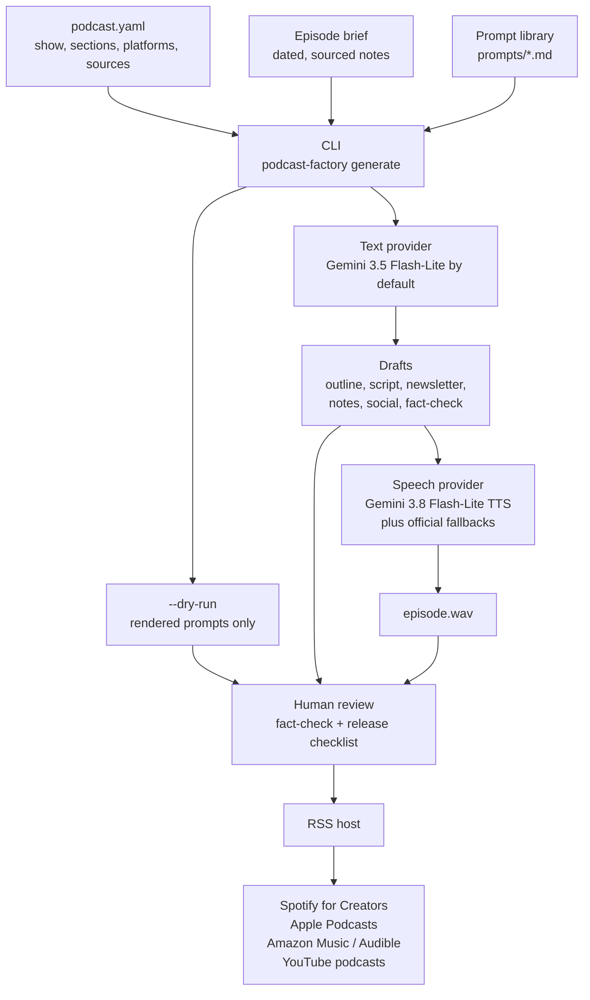

# Podcast Factory

A small shop, parish, nonprofit, or neighborhood group should not need a studio or a paid AI plan to start a short, honest podcast. **Podcast Factory** gives you a show config, a prompt library, and a Python CLI that turns a weekly brief into an outline, a narration script, a newsletter, and optional text-to-speech audio.

The default models are on the [Gemini Developer API](https://ai.google.dev/gemini-api/docs/pricing) free tier (checked November 25, 2026). You can render every prompt with `--dry-run` and no API key at all.

This is a public, reusable version of the workflow behind [The Portage Park Peep](https://podcasts.apple.com/us/podcast/the-portage-park-peep/id6821809652), a real weekly neighborhood briefing for Portage Park on Chicago's Northwest Side. The Peep also has a written newsletter. Listen on [Apple Podcasts](https://podcasts.apple.com/us/podcast/the-portage-park-peep/id6821809652) or [Spotify](https://open.spotify.com/show/40UbvjZeck7eolR0Z6sJmY). The sample brief in this repo is fictional, so you can try the tool without copying a live news week, and the repo does not publish listener counts or private contact details.

## The problem

Most small organizations already have the raw material for a short show: a calendar, a weather note, a couple of sourced local stories, a deadline people keep missing. What they lack is a repeatable way to:

- keep the same segments every week
- write for the ear, not a press release
- produce a written edition from the same facts
- use a free-tier model without inventing quotes or numbers
- get a first-pass voiceover they can actually review

## What it does

1. You fill in `podcast.yaml` (show name, audience, tone, cadence, sections, hosts and voices, platforms, written edition, sources, language).
2. You write a dated episode brief with only facts you have checked.
3. The CLI fills a prompt library (concept, research and outline, script, newsletter, show notes, social posts, titles, fact-check).
4. In `--dry-run`, it stops there. In a live run, it calls Gemini for the outline, script, and written edition.
5. Optionally it synthesizes speech with Gemini TTS, section by section, with fallbacks if a model is unavailable.
6. A person reviews the fact-check and the [release checklist](docs/release-checklist.md) before anything is published to RSS, Spotify for Creators, Apple Podcasts, Amazon Music, or YouTube.

It will not post, email, or publish for you.

## Quick start

Python 3.11 or newer is required.

```bash
git clone https://github.com/elderibeiro/podcast-factory.git
cd podcast-factory
python3 -m venv .venv
source .venv/bin/activate
pip install -e ".[dev]"

# No API key needed:
podcast-factory validate
podcast-factory generate --dry-run --brief examples/brief.md --output out

# Live generation (free-tier Gemini key):
cp .env.example .env   # then set GEMINI_API_KEY, see docs/gemini-api-key.md
podcast-factory generate --brief path/to/your-brief.md --output out
podcast-factory generate --brief path/to/your-brief.md --output out --with-audio
```

To start from a generic shop or parish config instead of the Peep example:

```bash
cp examples/generic-shop.yaml podcast.yaml
```

## Architecture



The text and speech layers are pluggable (`TextProvider` / `SpeechProvider`). Gemini is the built-in default because it still has a documented free tier for both text and TTS. You can add another vendor behind the same interface.

## Example: a dry run

From the repo root, with the bundled fictional brief and no API key:

```text
$ podcast-factory generate --dry-run --brief examples/brief.md --output out
Dry run written to out
  out/prompts/00-show-concept-prompt.md
  out/prompts/01-research-outline-prompt.md
  out/prompts/02-script-prompt.md
  out/prompts/03-newsletter-prompt.md
  out/prompts/04-show-notes-prompt.md
  out/prompts/05-social-posts-prompt.md
  out/prompts/06-titles-thumbnails-prompt.md
  out/prompts/07-fact-check-prompt.md
No API key was used.
```

A shortened excerpt from the rendered research-outline prompt looks like this (the real file is longer and includes the full brief):

```markdown
# Episode research and outline

You are a careful producer for "The Portage Park Peep", Your Monday morning
neighborly nudge from the Northwest Side. Work only from the episode brief
and the source list below. If a fact is missing, mark it as a question —
do not invent it.

## Show rules
- Audience: Neighbors, small shop owners, and anyone who wants a short,
  local catch-up they can finish with their coffee.
- Target length: about 5 minutes
- Cadence: Weekly, on Monday
- Recurring sections, in order:
- Lead story (lead, required, ~45s) — The week's one story worth opening with.
- This Week's Snapshot (snapshot, required, ~40s) — Weather, calendar, and
  one practical note for the days ahead.
- Commerce Corner (commerce, required, ~35s) — Shop openings, events, and
  neighborhood business news.
…

## Episode brief (source notes from the producer)
# Sample episode brief (fictional)
This brief is **made up** so you can run the CLI without copying a real news week.
…
Working title: Lights On, Leaves Off
```

A committed copy of a dry-run folder is in [`examples/dry-run-output/`](examples/dry-run-output/), so you can read the prompts without installing anything.

## Config fields

`podcast.yaml` is the whole show bible. The important fields are:

| Field | What to fill in |
| --- | --- |
| `show.name`, `tagline`, `niche` | Who you are and what the show covers |
| `target_audience`, `tone`, `language` | How it should sound |
| `release_frequency`, `episode_length` | A cadence you can keep |
| `sections` | Recurring segments, including optional rotating ones |
| `hosts` | Narrator name, role, Gemini voice (for example `Kore`), and style |
| `platforms` | RSS, Spotify for Creators, Apple Podcasts, Amazon Music, YouTube |
| `written.enabled` | Newsletter or blog edition on or off |
| `sources`, `news_inputs` | Where facts are allowed to come from |
| `models` | Provider and model IDs; defaults are free-tier Gemini |

The Peep example in the root `podcast.yaml` follows the real show's Monday, ~5-minute shape and its recurring segments (welcome, lead, snapshot, Commerce Corner, Mild-Mannered Mischief Report, Homeowner's Huddle, Park and Rec, with rotating history, civic, and natter beats). The live show is narrated with hosted text-to-speech and is published with a written newsletter. This toolkit generalizes that pipeline and defaults to Gemini so other groups can run it on the free tier.

## Prompt library

| File | Purpose |
| --- | --- |
| `prompts/01-show-concept.md` | Positioning, voice guide, and a reusable sign-off |
| `prompts/02-research-outline.md` | Section-by-section outline with sources and open questions |
| `prompts/03-script-section.md` | Narration script, split by `---`, written for TTS |
| `prompts/04-blog-newsletter.md` | Written edition plus a source list |
| `prompts/05-show-notes.md` | Titles and directory descriptions |
| `prompts/06-social-posts.md` | Short posts a volunteer can paste |
| `prompts/07-titles-thumbnails.md` | Title and thumbnail options |
| `prompts/08-fact-check-safety.md` | Accuracy, safety, and disclosure review |

## Default models (November 2026)

Verified against [Gemini Developer API pricing](https://ai.google.dev/gemini-api/docs/pricing) and the [speech generation](https://ai.google.dev/gemini-api/docs/speech-generation) docs on November 25, 2026:

- Text: `gemini-3.5-flash-lite` (free-tier row; lower paid price if you upgrade later)
- Speech: `gemini-3.8-flash-lite-tts`, falling back to `gemini-3.8-flash-tts`, then `gemini-3.1-flash-tts-preview`, then `gemini-2.5-flash-preview-tts`

Get a key in [Google AI Studio](https://aistudio.google.com/apikey). Details, privacy notes, and a cost table are in [docs/gemini-api-key.md](docs/gemini-api-key.md) and [docs/costs.md](docs/costs.md).

## Publishing

This tool does not upload episodes. After you review the drafts, host an RSS feed and submit it to the directories you listed in the config. Guides:

- [Publishing via RSS](docs/publishing.md) — Spotify for Creators, Apple Podcasts Connect, Amazon Music, YouTube
- [AI disclosure](docs/ai-disclosure.md)
- [Release checklist](docs/release-checklist.md)

## Development

```bash
pip install -e ".[dev]"
pytest
podcast-factory generate --dry-run --brief examples/brief.md --output out
```

## License and credit

[MIT](LICENSE) © 2026 [Elder Lira](https://github.com/elderibeiro).

Built as a public portfolio of practical AI use for small organizations, including work in the spirit of an [OpenAI OpenWorks](https://openai.com/openworks/) partner helping local groups use AI on real weekly tasks. The Portage Park Peep remains a neighborhood show; this repository is the generalized toolkit, not the show's private production archive.
